## AWS Setup


## Create a secret in Secret Manager:
  - Secrets Manager never keeps the secret in clear on its disks.
  - It encrypts it with a key managed by AWS KMS (Key Management Service), the AWS service dedicated to encryption keys.
  - When someone reads the secret with `GetSecretValue`, Secrets Manager decrypts it on the fly with that same key.
  - There are 2 choices:
    - `aws/secretsmanager` (the default);
    - a customer-managed key.

    Tips: Store the secret as **Plaintext**, with the token only: no key/value JSON, no quotes, no trailing newline. Otherwise GitHub answers *401 Bad credentials*.

  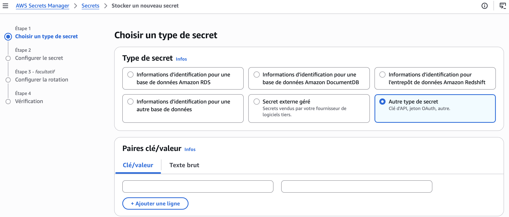
  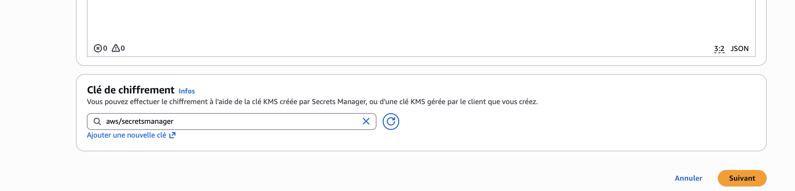
  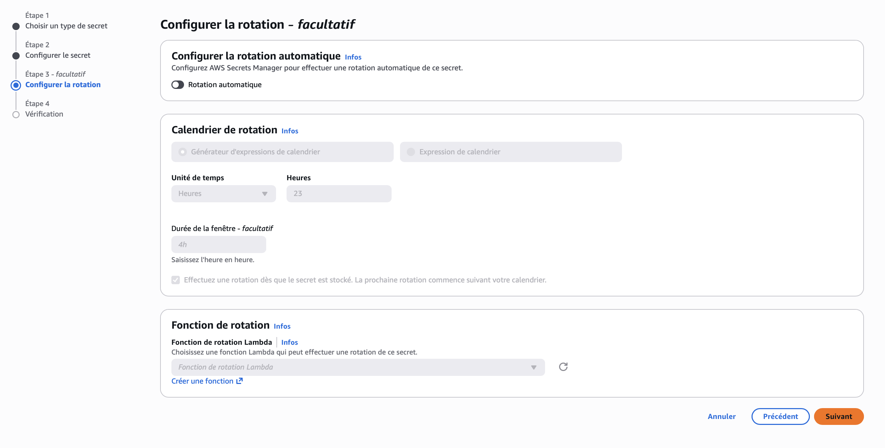
  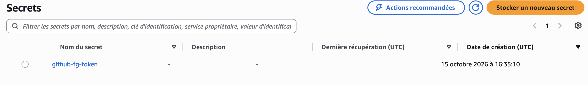

## Create an IAM:

  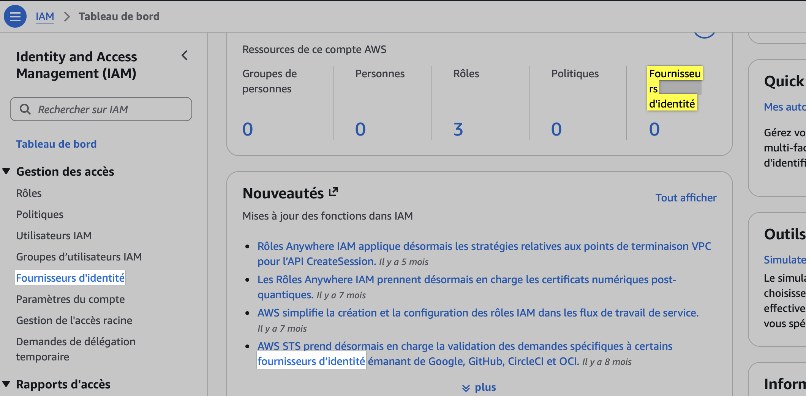
  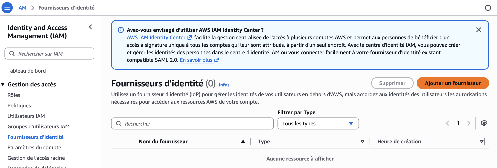
  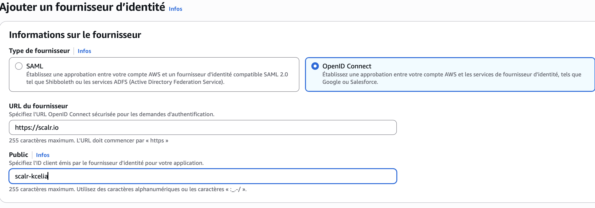
  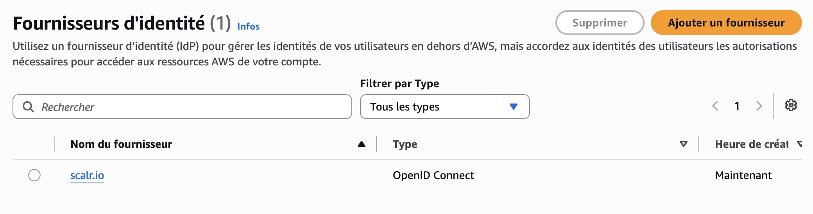

  - OIDC (OpenID Connect) is an authentication protocol. Here, it lets Scalr authenticate to the AWS account with no stored secret: no access key, no password.


  - IAM is the gatekeeper.
  - It is the service that manages every identity and every permission of the AWS account.
  - Every call to any AWS service goes through it.
  - It holds the users, the roles, the policies and the identity providers, such as `scalr.io`, added here.

## Create an IAM role:

A **role** is a temporary identity (a badge) that Scalr assumes during a run. No password.
It carries two kinds of policies:

| Policy | Question |
|---|---|
| Trust policy | **Who** can assume the role? |
| Permissions policies | **What** can the role do? |

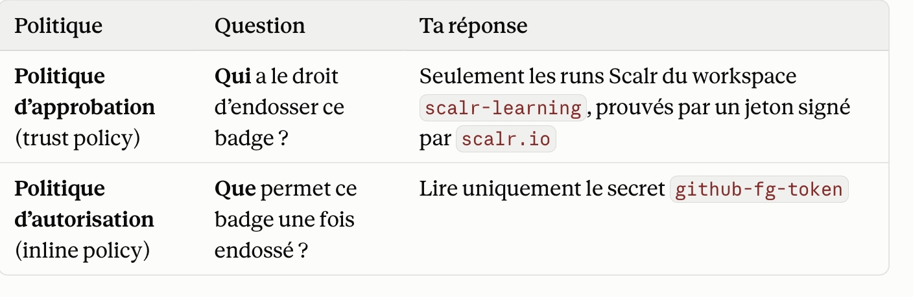
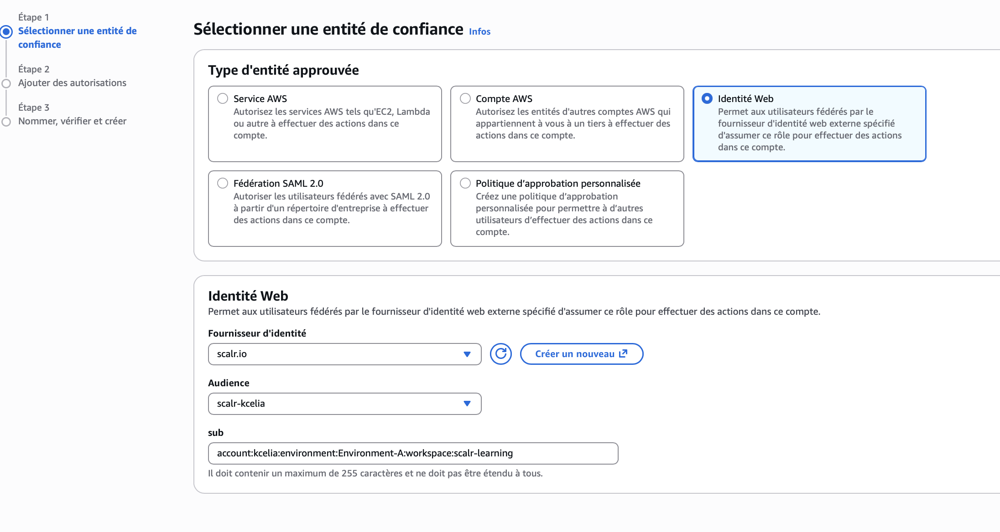


### Trust policy: the `sub`

`sub` is a claim in the token Scalr signs at each run. It identifies the caller:
`account:kcelia:environment:Environment-A:workspace:scalr-learning`
Scalr builds it from the real names (case-sensitive). Only this workspace can assume the role.

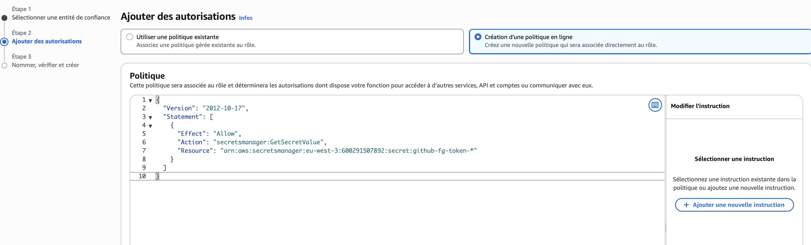

### Permissions policies

One role, two inline policies:

| Policy | Allows |
|---|---|
| `scalr-learning-secrets-readPolicy` | Read 2 secrets in Secrets Manager |
| `scalr-poc-ssm-write` | Create, read, delete SSM parameters under `/scalr-poc/` |

**`scalr-learning-secrets-readPolicy`**
`??????` matches the 6 random characters AWS appends to secret ARNs (`-*` also works).

```json
{
  "Version": "2012-10-17",
  "Statement": [
    {
      "Effect": "Allow",
      "Action": "secretsmanager:GetSecretValue",
      "Resource": [
        "arn:aws:secretsmanager:eu-west-3:600291507892:secret:github-fg-token-??????",
        "arn:aws:secretsmanager:eu-west-3:600291507892:secret:poc-fake-secret-??????"
      ]
    }
  ]
}
```

**`scalr-poc-ssm-write`** (needed for the write-only test)
IAM → Roles → `scalr-learning-secrets-read` → Permissions → Add permissions → Create inline policy.

```json
{
  "Version": "2012-10-17",
  "Statement": [
    {
      "Effect": "Allow",
      "Action": [
        "ssm:PutParameter",
        "ssm:GetParameter",
        "ssm:GetParameters",
        "ssm:DeleteParameter",
        "ssm:AddTagsToResource",
        "ssm:ListTagsForResource"
      ],
      "Resource": "arn:aws:ssm:eu-west-3:600291507892:parameter/scalr-poc/*"
    },
    {
      "Effect": "Allow",
      "Action": "ssm:DescribeParameters",
      "Resource": "*"
    }
  ]
}
```

`ssm:DescribeParameters` cannot be scoped to a resource, hence `"*"`.

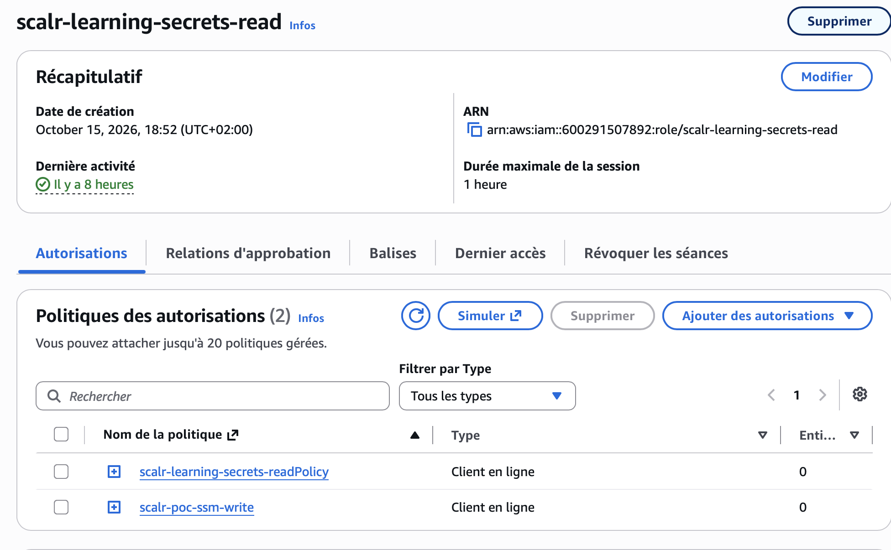
