# Scalr POC

**Goal**: find out if [Scalr](https://scalr.com) is a good option to:
- Store the Terraform state
- Run `plan`/`apply` in one shared place for the whole team**, rather than on individual laptops.

**Current setup:**
- The Terraform state file is stored in an AWS S3 bucket.
- Terraform reaches the bucket with static AWS access keys, kept in 1Password and injected on the laptop at each run (`op run`).
- `plan` and `apply` run on each engineer's laptop.
- No drift detection: a change made directly in a service, for example in the Grafana UI, goes unnoticed until someone runs a `plan`.

**Reference:** accounts, tools, files and commands are in [REFERENCE.md](REFERENCE.md).

## The use-case we want to build

```
push ──▶ workflow push-metrics: fmt + init -backend=false + validate
           └─ on main only ──▶ success=1 or 0 ──▶ Grafana Cloud metrics
                                                    ├─▶ dashboard "GitHub push results"
                                                    └─▶ alert "main is broken" ──▶ email
```

## What is Scalr

Scalr is a SaaS platform for Terraform and OpenTofu, an alternative to HCP Terraform. It:
- **replaces the S3 bucket**: stores, locks and versions the state;
- **replaces the laptop**: runs `plan` and `apply` on its own runners;
- **adds** approvals, run history, permissions and drift detection.

- To find a run: on GitHub, the commit or PR check → **Details**; in Scalr, **Workspace → Runs → History** : 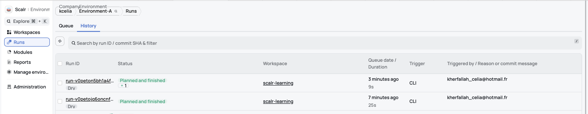

> In Terraform terms, Scalr is the *backend* (stores the state); *providers* (Grafana, GitHub) create the resources.

> A plan compares resources (code, state, real services), not variables: as long as no resource used a secret, the plan said *No changes*.

### Variables in Scalr

  - A variable is **declared** in the code (`variable` block) and gets its **value** from the workspace, set in one of 3 ways:
    - the Scalr UI: **Workspace → Variables → Create variable**;
    - the Scalr API: what `scripts/push_vars_to_scalr.py` does;
    - the Scalr Terraform provider: `scalr_variable`.

  - Scalr has [2 categories of variables](https://docs.scalr.io/docs/variables):
    - Terrafrom: fills the `variable` block of the same name
    - Shell: exports it as an environment variable

  - <!> Sensitive variables: Scalr masks them in the UI and the API. The state still stores them in clear once a resource uses them. 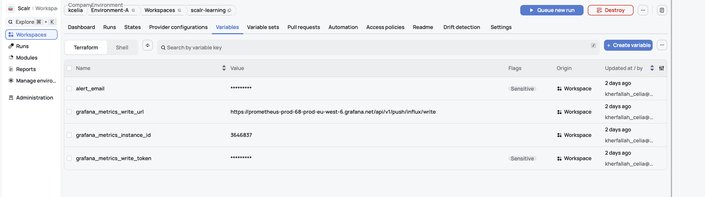


### How Scalr is organized

| Level | What it is | In this POC |
|---|---|---|
| **Account** | the company space | `kcelia` (`https://kcelia.scalr.io`) |
| **Environment** | a group of workspaces sharing the same rules: access, variables, policies, drift detection | `Environment-A` (`env-v0pejs6i46opjvptq`) |
| **Workspace** | one configuration with its state, variables, settings and run history | `scalr-learning` (`ws-v0peq0rl8d46th07e`) |

### Where runs are executed and what starts them

**Execution mode: where the run executes.**

| Mode | `plan` / `apply` run on | Scalr provides |
|---|---|---|
| **Remote** (default) | Scalr's runners | state, variables, provider configurations, policies, approvals |
| **Local** | the laptop | the state only  |

> A remote run does not see the laptop's environment: every variable and secret the code needs must be set in the workspace.

**Workspace type: what starts a run.** It can be changed at any time without moving the state; this POC switched from CLI-driven to VCS-driven.

| Type | Trigger | Typical use | POC |
|---|---|---|---|
| **CLI-driven** | `tofu plan / apply` in a terminal | an engineer tests a change from a terminal | ✅ tested |
| **VCS-driven** | PRs and merges in the Git repository | the team reviews every change in a PR before it is applied | ✅ tested |
| **API-driven** | a script calling the Scalr API | an existing pipeline decides when to send the code | not tested |
| **No-code** | a form in the Scalr UI: pick a registry module, fill in its variables | someone who does not write Terraform deploys a standard module | not tested |

**CLI-driven workspace**
- ✅ `plan` and `apply` start from the laptop but run on Scalr's runners, and every run is tracked.
- ⚠️ Whoever starts the run also approves it (`yes` in the terminal): no second review.
- ⚠️ The local folder is uploaded, uncommitted code included: any branch can be applied.

**VCS-driven workspace**
- ✅ A PR starts a plan-only run, shown as a GitHub check.
- ✅ A push or merge to `main` starts a plan that waits for approval in Scalr (auto-apply off); the commit status shows the result.
- ✅ `make apply` from a laptop is refused: *"Apply not allowed for workspaces with a VCS connection"*.
- ⚠️ `make plan` from a laptop still works: it runs local, uncommitted code with the workspace secrets.

### Drift

> **A plan compares 3 things:** the code (what you want), the state (what Terraform manages) and the real services, read at each plan (`Refreshing state…`).

- A **drift** is a gap between the code and the real services, caused by a change made outside Terraform: a click in the Grafana UI, a direct API call, or the service itself.
- Any plan detects it. Scalr's drift detection adds a free **scheduled** plan, set **per environment** (daily or weekly).
- On drift, choose *Ignore*, *Sync State* (the state accepts reality) or *Revert Infrastructure* (the code wins: a plan and apply rolls the change back). Sync and Revert count as regular runs.
- ⚠️ Grafana locks the alert rules and contact points Terraform creates ("Provisioned"): no edit or pause in the UI, unless `disable_provenance = true`. The API and dashboards are not locked.
- **Environment settings → Drift detection → Daily**.

Drift:
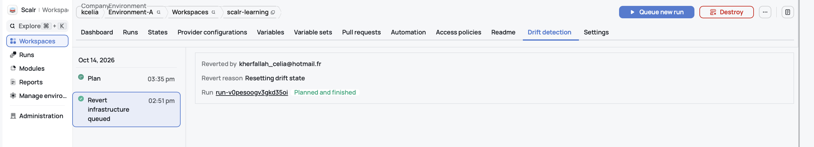
In VCS mode, you need to approve the run:
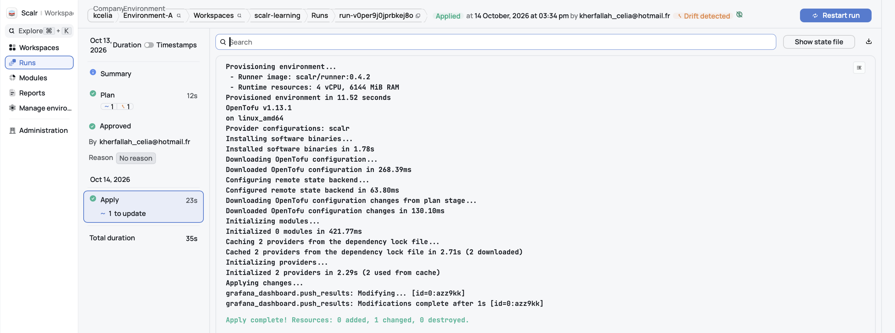
Revert a drif:
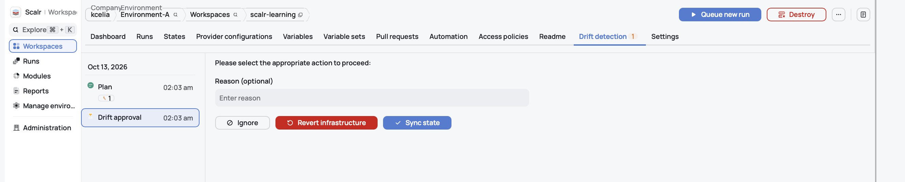

### Scalr needs OpenTofu

Since 1.6, Terraform is licensed under the **Business Source License (BSL)**, which bars competing platforms such as Scalr from running it.
Scalr therefore supports Terraform only up to **1.5.7**, the last open-source version.
Beyond that, it uses **OpenTofu**: the open-source fork of Terraform, hosted by the Linux Foundation, with the same HCL and providers.

> **Finding:** prod runs Terraform `1.15.8`, so adopting Scalr means migrating prod to OpenTofu (as this POC did) or downgrading to Terraform 1.5.7.

## OpenTofu / AWS Secrets Manager / Scalr

**Goal**: see how our current tools can handle secrets and if a secret can stay out of the Terraform state.

### Approach 1: Scalr sensitive variables
- Scalr lets you store a secret as a variable marked **sensitive**.
- In the POC, `make push-vars-to-scalr` pushes these secrets from 1Password to Scalr through the API.
  Nothing records who ran it: Scalr audit logs require the Enterprise plan.
- **Limit**: "sensitive" - the dashboard only hides the value in the UI and logs. Once a resource uses it, the value is stored **in clear in the state** (tested with `poc_fake_secret`).
- Scalr encrypts the state at rest (AES-256), but anyone with `state-versions:read` can read the secrets inside.

### Approach 2: AWS Secrets Manager + OpenTofu `ephemeral`
- Secrets live in AWS Secrets Manager, not in Scalr.
- Each run gets temporary AWS credentials through an OIDC provider configuration: no AWS key is stored in Scalr.
- The IAM role only lets the `scalr-learning` workspace (`sub` claim) read the listed secrets.
- The code reads the secret with an OpenTofu `ephemeral` resource: the value stays in memory during the run and is never written to the state or the plan.

**Results**: what reaches the state depends on how the code uses the secret, not on where it is stored.

| Usage | In the state? |
|---|---|
| Read with `data` | ❌ Yes, in clear (tested) |
| Read with `ephemeral`, used in a `provider` block | ✅ No (tested, GitHub token) |
| `ephemeral` → write-only attribute `_wo` | ✅ No, stored as `null` (tested, `aws_ssm_parameter.value_wo`) |
| Resource without a `_wo` attribute (e.g. `github_actions_environment_secret`) | ❌ OpenTofu refuses ephemeral; a normal variable lands in clear |

**Rule**: before passing a secret to a resource, check whether the attribute has a `_wo` version.

### Remaining risks and options
- A secret that already reached the state stays in older state versions: rotate it.
- Scalr remains a trusted third party: it can assume the role and read the allowed secrets.
  Mitigations: least privilege, CloudTrail monitoring, short-lived tokens.
- For secrets that must go to resources without _wo: encrypt the state with OpenTofu and AWS KMS (not tested). The secret stays in the state, but Scalr stores only ciphertext. Trade-off: Scalr's drift detection and resource views stop working on that workspace (to be tested)

## Setup

### Common steps

1. `make setup` installs the required tools.
1. In Grafana Cloud, create a stack, then:
   - a service account `terraform-scalr` (role Admin) and its token: OpenTofu configures the stack with it;
   - a metrics token (stack **Details → InfluxDB → Configure**, scope `metrics:write`): the workflow pushes data with it.
1. On GitHub, create a fine-grained token for this repo only: **Administration** and **Environments**, read and write.
1. Create a Scalr API token with `tofu login kcelia.scalr.io`. It writes the token in plain text to `~/.terraform.d/credentials.tfrc.json`: copy it to 1Password, then delete it from the file (if you keep it, `chmod 600` the file).
   - OpenTofu looks for the token in this order:
     1. the environment variable `TF_TOKEN_kcelia_scalr_io` (`TF_TOKEN_` + the host, dots replaced by underscores);
     2. `~/.terraform.d/credentials.tfrc.json`, written by `tofu login`, in plain text;
     3. a credentials helper.

     The POC uses the first one:
     ```make
     # The Makefile holds the 1Password reference, not the token
     SCALR_TOKEN_ENV := $(SCALR_TOKEN_VAR)=op://terraform-scalr-poc/scalr-poc-token/credential
     TF := $(SCALR_TOKEN_ENV) op run -- tofu
     ```
1. Store the 4 tokens in the 1Password vault `terraform-scalr-poc`: `grafana-terraform-scalr-token`, `grafana-github-metrics-write-token`, `github-fg-token`, `scalr-poc-token`.
1. Copy `.env.example` to `secrets.env.op` (git-ignored) and fill it: 1Password references only, never values.
1. `make push-vars-to-scalr`
   - copies the variables to the Scalr workspace through the Scalr API with the values `op run` reads from 1Password and `secrets.env.op`.
   - Run it once, then again whenever a value changes

- **What `make plan` sends to Scalr**
  - `tofu` packs the local folder into an archive (a *slug*) and uploads it; the Scalr runner runs the plan from that archive, uncommitted code included.
  - Only `.terraformignore` filters the archive, not `.gitignore`. Without it, everything except `.git/` and `.terraform/` was uploaded, git-ignored files included: `secrets.env.op`, the screenshots, any local `*.tfstate`.
  - The repo's `.terraformignore` is an allowlist: it excludes everything, then keeps only what OpenTofu reads.
    ```
    *
    !*.tf
    !.terraform.lock.hcl
    ```
  - Tested with go-slug `v0.16.8`, the library OpenTofu `1.13.1` uses to build the archive: the archive now holds only the 7 `.tf` files and `.terraform.lock.hcl`.
  - If the code starts reading another file (a template, a local module), add it to `.terraformignore`: otherwise the run fails, because the file is missing on the runner.

### Scenario 1: CLI-driven (commit `00a4d4d`)

1. Add the `backend "remote"` block to `versions.tf`: Scalr host, environment, workspace.
1. `make init`, then `make migrate-state`: copy the local state to the workspace `scalr-learning` (one time only).
1. `make push-vars-to-scalr`: copy the 9 variables (4 sensitive) to the workspace.
1. ⚠️  plan and apply can be executed on one's laptop
1. `make plan`
1. `make apply` (to be confirmed locally : `yes`)
1. Both plan and apply run on scalr runners.

### Scenario 2.1: VCS-driven + secrets in Scalr env

1. **Scalr: Workspace → Settings → Source → Configuration source: VCS**: repository, branch `main`, trigger "any change", auto-apply off. Same workspace, same state.
   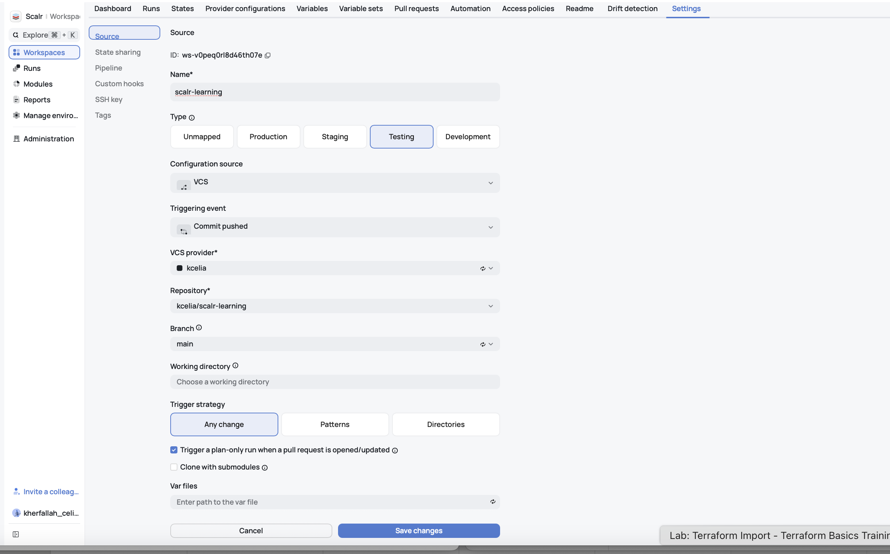
2. **Make a change:** two sensitive Scalr variables:

   | Variable | Type | Used by | Plan | Apply | In the state? |
   |---|---|---|---|---|---|
   | `GITHUB_TOKEN` | Shell, pushed by `make push-vars-to-scalr` | the GitHub provider, to authenticate | ✅ runs; the token never appears | ✅ runs | ✅ No: the provider reads it from the environment, and OpenTofu never writes a provider's configuration to the state |
   | `poc_fake_secret` | Terraform: value set in the Scalr UI, declared in `variables.tf` | `github_actions_environment_secret.poc_fake`, which creates the GitHub secret `POC_FAKE_SECRET` | ✅ runs after commit `86a7417`, which declares the variable and adds the resource: `1 to add`, `value = (sensitive value)` | ✅ creates `POC_FAKE_SECRET` | ❌ Yes, in clear: `value` is a resource attribute, and OpenTofu stores every resource attribute in the state; `sensitive` only masks it in the UI and the plan |

    > A value set in the Scalr UI starts no run: in VCS mode, only a commit does. As long as no resource used the variable, the plan said *No changes*.
3. **Plan:**:
   - `make plan` from the laptop shows `value = (sensitive value)`:
     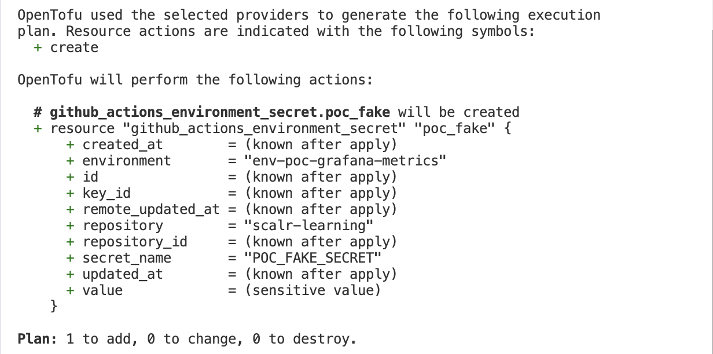
   - The terminal prints the link to the run in Scalr.
     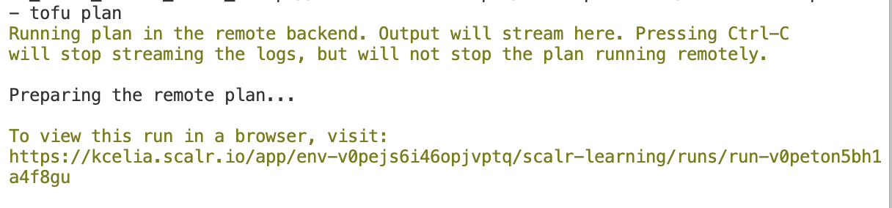
     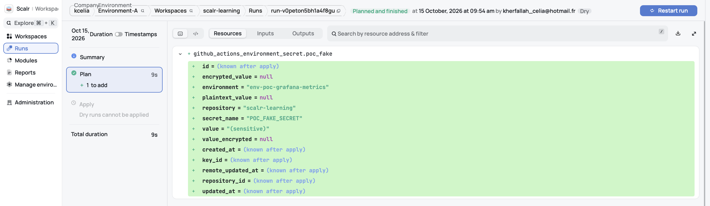

4. **Apply:**
   - Push or merge to `main`: Scalr runs a plan, then waits for approval (auto-apply off). Approve it in **Runs → Queue** or on the run page.
     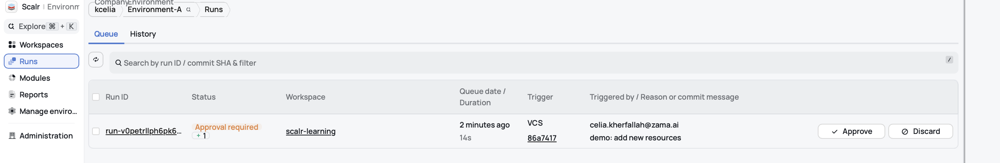
     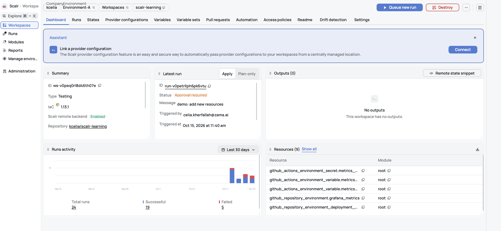
     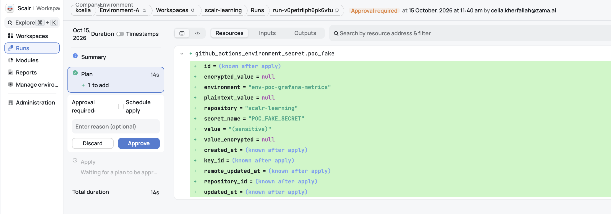
   - On GitHub, the commit lists every check: 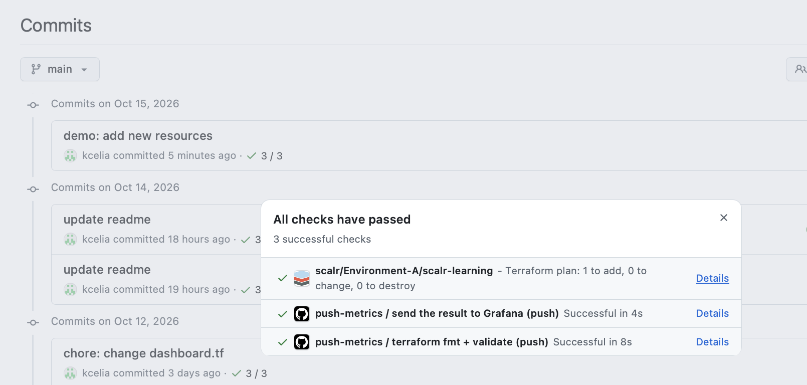

      The run executes on Scalr's runners, not on GitHub: GitHub only shows the status Scalr sends it.

      The logs stay in Scalr; **Details** links to them.

5. **Check manually the state:**

  - From terminal:
   ```bash
   # Download the latest state (mode 600, outside the repo):
   (umask 077 && TF_TOKEN_kcelia_scalr_io=op://terraform-scalr-poc/scalr-poc-token/credential op run -- tofu state pull > ~/Downloads/scalr-learning.tfstate)

   # GITHUB_TOKEN. Expected: 0.
   GITHUB_TOKEN=op://terraform-scalr-poc/github-fg-token/credential op run -- sh -c 'printenv GITHUB_TOKEN | grep -c -F -f /dev/stdin ~/Downloads/scalr-learning.tfstate'

   # poc_fake_secret. Expected: its value, in clear (empty since scenario 2.2 removed the resource).
   jq -r '.resources[] | select(.type == "github_actions_environment_secret" and .name == "poc_fake") | .instances[0].attributes.value' ~/Downloads/scalr-learning.tfstate

   # Delete the file: it holds real secrets.
   rm ~/Downloads/scalr-learning.tfstate
   ```
  - From Scalr UI: each row is a version of the state.
    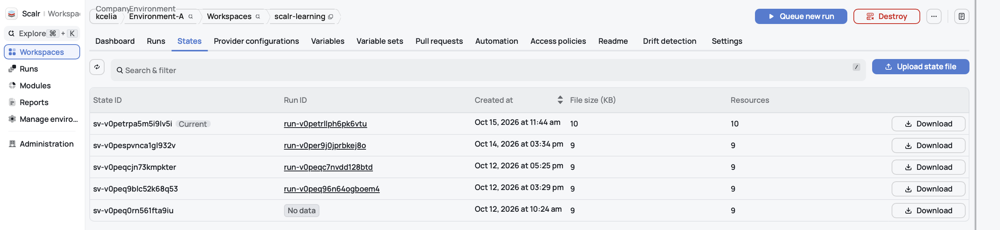


### Scenario 2.2: VCS-driven + secrets in AWS secret manager

#### What happens during a Scalr run
1. Scalr starts a run and creates a signed token that says "I am the workspace `scalr-learning` of the environment `Environment-A` in the account `kcelia`".
2. The runner presents this token to AWS and asks to assume the role `scalr-learning-secrets-read`.
3. IAM checks the trust policy: does the token come from `scalr.io` (the declared provider), is the audience `scalr-kcelia`, does the workspace match? If so, it hands out temporary credentials, valid for the duration of the run.
4. The OpenTofu code calls Secrets Manager with these credentials to read `github-fg-token`.
5. IAM checks the permissions policy: may this role call `GetSecretValue` on this secret? Yes, so Secrets Manager decrypts the secret and returns its value.
6. At the end of the run, the credentials expire. There is nothing to revoke.

#### Steps

1. **AWS: 3 secrets.**
   - `github-fg-token` (Secrets Manager): used only to authenticate the GitHub provider.
   - `poc-fake-secret` (Secrets Manager): used by resources.
   - `/scalr-poc/poc-fake-secret` (SSM Parameter Store): created by OpenTofu from `poc-fake-secret`, through the write-only attribute `value_wo`.

   > **SSM Parameter Store**: a free AWS key/value store; with the type `SecureString`, the value is encrypted.

   See [AWS setup](AWS-SETUP.md#create-a-secret-in-secret-manager).

1. **AWS IAM:** Scalr (`https://scalr.io`, audience `scalr-kcelia`) is added as an OIDC identity provider: runs authenticate to AWS with no stored key.
   See [AWS setup](AWS-SETUP.md#create-an-iam).

1. **AWS IAM role:** one role, `scalr-learning-secrets-read`, that only the `scalr-learning` workspace can assume, with 2 inline policies: read the 2 secrets and manage the SSM parameters under `/scalr-poc/`.
   See [AWS setup](AWS-SETUP.md#create-an-iam-role).


1. **Scalr:** create the AWS [provider configuration](https://docs.scalr.io/docs/provider-configurations).
  - `Scope Account > Inventory → Provider configurations → Create configuration → AWS`.
  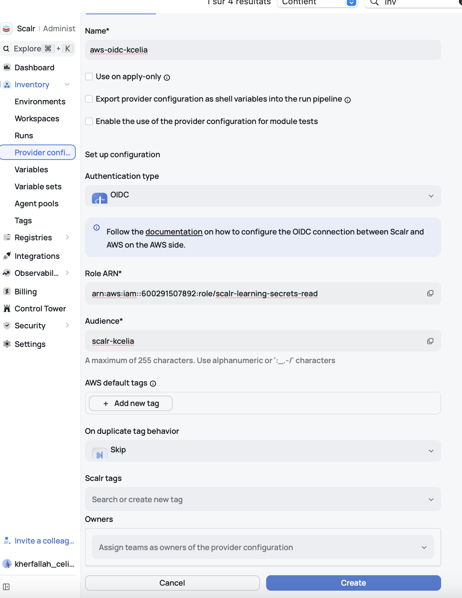

  - Share it with our environment:
  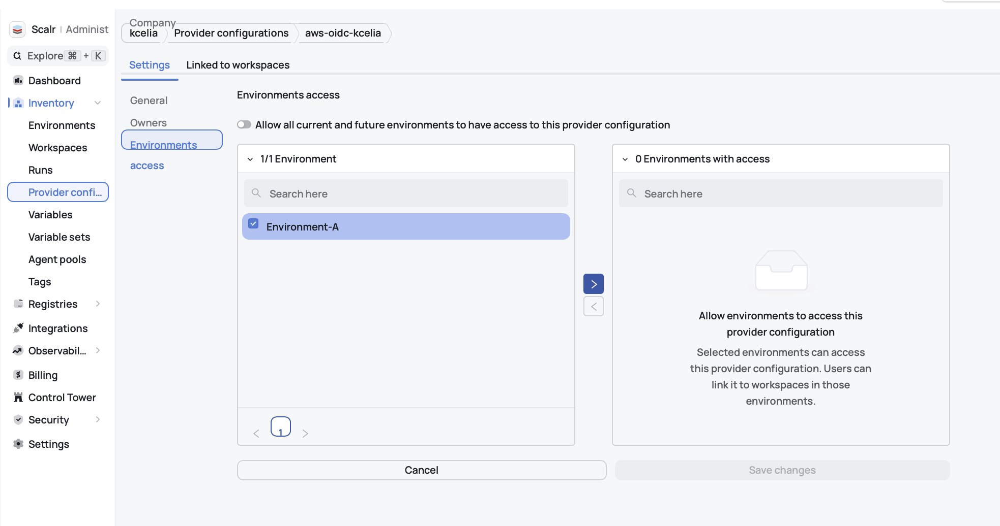
  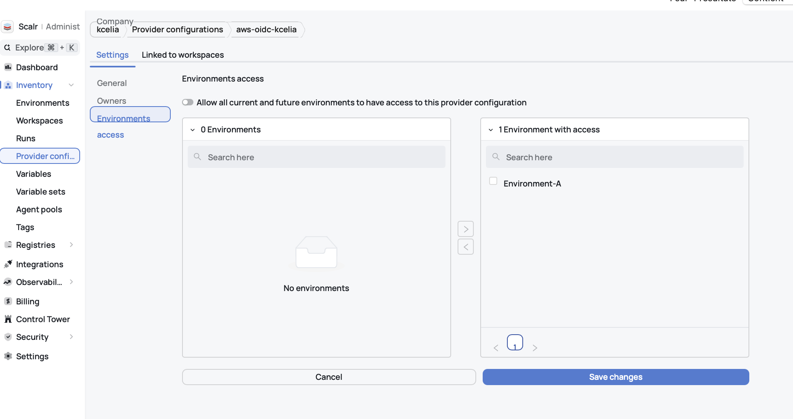

  - It is now available to the environment, but no workspace uses it yet. So: `Workspace > Provider configurations`:

  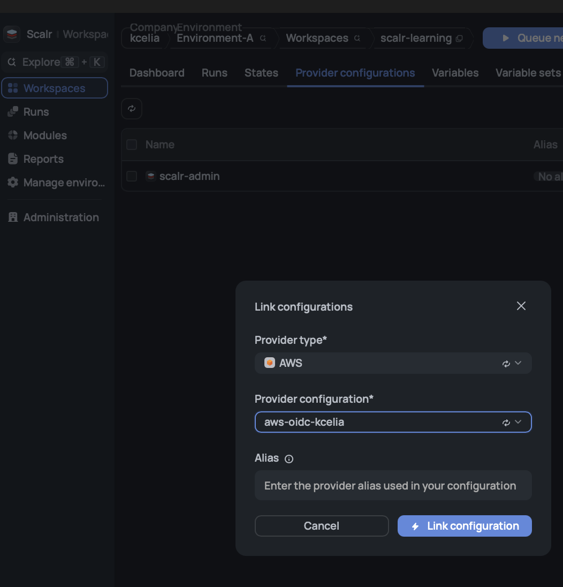

  - Expected result: `aws-oidc-kcelia` is now linked to the workspace `scalr-learning`, next to `scalr-admin`. The Scalr configuration is complete; only the code is left.

  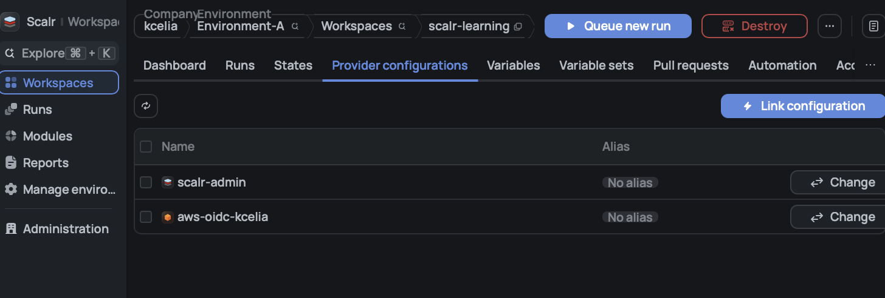

1. Code changes:
  - `GITHUB_TOKEN` removed from the Scalr shell variables.

1. `make plan`, then commit, push and approve in Scalr:

   | Secret | Read with | Used by | Plan | Apply | In the state? |
   |---|---|---|---|---|---|
   | `github-fg-token` | `ephemeral` | the GitHub provider, to authenticate | ✅ runs | ✅ runs | ✅ No: an ephemeral value stays in memory, and the provider block that uses it is never written to the state |
   | `poc-fake-secret` | `data` | nothing | ✅ runs | ✅ runs | ❌ Yes, in clear: OpenTofu stores every data source result in the state |
   | `poc_fake_secret` (Scalr variable), declared `ephemeral = true` | variable | `github_actions_environment_secret.value` | ❌ fails: *Ephemeral value used in non-ephemeral context* | not reached | — Refused before anything is written: `value` is not write-only |
   | `poc-fake-secret` (**write-only `_wo` test**) | `ephemeral` | `aws_ssm_parameter.value_wo` | ✅ runs | ✅ creates the SSM parameter `/scalr-poc/poc-fake-secret` | ✅ No: a write-only attribute is sent to the provider but never stored (`value` empty, `has_value_wo = true`) |

   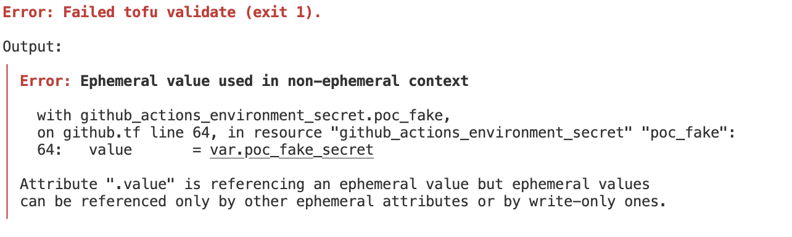

1. **Check manually the state:**

   ```bash
   # Download the latest state (mode 600, outside the repo):
   (umask 077 && TF_TOKEN_kcelia_scalr_io=op://terraform-scalr-poc/scalr-poc-token/credential op run -- tofu state pull > ~/Downloads/scalr-learning.tfstate)

   # github-fg-token. Expected: 0.
   GITHUB_TOKEN=op://terraform-scalr-poc/github-fg-token/credential op run -- sh -c 'printenv GITHUB_TOKEN | grep -c -F -f /dev/stdin ~/Downloads/scalr-learning.tfstate'

   # poc-fake-secret through data. Expected: fake-sm-123.
   jq -r '.resources[] | select(.mode == "data" and .type == "aws_secretsmanager_secret_version") | .instances[0].attributes.secret_string' ~/Downloads/scalr-learning.tfstate

   # poc-fake-secret through value_wo. Expected: value empty, has_value_wo true.
   jq '.resources[] | select(.type == "aws_ssm_parameter" and .name == "poc_fake") | .instances[0].attributes | {value, value_wo, has_value_wo, value_wo_version}' ~/Downloads/scalr-learning.tfstate

   # Delete the file: it holds real secrets.
   rm ~/Downloads/scalr-learning.tfstate
   ```

## Conclusion

- `ephemeral` is an OpenTofu feature, available from version 1.11.
- `ephemeral` keeps a secret out of the state and the plan, on 2 possible conditions:
  - the value goes to a `provider` block (authentication), **or**
  - the value goes to a write-only (`*_wo`) attribute, which only works if the provider supports write-only for that resource.

| Where the secret goes | Ephemeral possible? | Use case |
|---|---|---|
| `provider` block | ✅ Yes | Authentication: API token of a provider (GitHub, Grafana, Scalr...)<br>• Never in the state, whether it comes from a Scalr sensitive variable or from Secrets Manager read with `ephemeral` (a `data` read would store it)<br>• Secrets Manager adds: no secret stored in Scalr, IAM access control, and a CloudTrail audit of each read |
| Resource attribute with a `_wo` version | ✅ Yes, not stored (`value` empty, `has_value_wo = true`) | Sending a secret to a service: SSM parameter, Secrets Manager value, database password |
| Resource attribute without `_wo` | ❌ No: OpenTofu refuses it; a normal variable lands in clear in the state | Pushing a secret to a resource whose provider has no `_wo` (e.g. GitHub Actions secret)<br>• GitHub provider 6.13.0 and Grafana provider 3.25.9: no `_wo` attribute at all (checked with `tofu providers schema -json`)<br>• Remaining options: OpenTofu state encryption with AWS KMS (not tested), or let the consumer read the secret from AWS at runtime instead of passing it through OpenTofu |

**Rule**: before passing a secret to a resource, check whether the attribute has a `_wo` version. Where the secret is stored (Scalr, Secrets Manager) does not matter; how the code uses it does.

### Scalr vs GitHub Actions

| Criterion | Scalr + GitHub + Secrets Manager | GitHub Actions + S3 |
|---|---|---|
| **Plan / apply** | PR → plan (GitHub check); merge → apply after approval | Workflows to write |
| **IaC run management** | **Built in**: run queue per workspace, approvals, run history and logs, CLI dry runs, restart or discard a run | To build with workflows: `concurrency` groups, environment reviewers, job logs |
| **State** | At Scalr (GCP, US), with history | **In our S3 bucket** (KMS-encrypted, versioned) |
| **State locking** | Included | S3 lockfile to enable |
| **AWS credentials** | One central OIDC provider configuration | GitHub → AWS OIDC, per repo |
| **Where secrets live** | Secrets Manager (Scalr variables also possible) | GitHub environment secrets **or** Secrets Manager |
| **Secrets out of the state** | `ephemeral` + `_wo` attributes | Same: it is OpenTofu, not the tool |
| **Audit of secret reads** | CloudTrail | CloudTrail with Secrets Manager; none with GitHub secrets |
| **Governance** (RBAC, OPA) | **Built in** | To assemble (branch rules, `conftest`) |
| **Drift detection** | **Built in** | Scheduled workflow to write |
| **Visibility** | **Dedicated UI** (runs, resources, costs) | Job logs |
| **General CI** (fmt, tests, scripts) | Hooks possible, but slower | **Native, fast** |
| **Cost** | Scalr subscription, billed per run | **Almost free** |
| **Setup** | **Fast** | Longer: everything to build |
| **Trusted third parties** | 3 (Scalr, GitHub, AWS) | **2 (GitHub, AWS)** |
| **Scaling** | **Built for several teams and workspaces** | Heavy to maintain |

**In short:**
- IMO to manage file state for a big team (governance and visibility needed) -> Scalr

Utiliser un state distant : OpenTofu ne l’écrit alors plus sur le disque local, il le garde seulement en mémoire.
Chiffrer au repos côté backend : par exemple l’option encrypt du backend S3. C’est l’équivalent du chiffrement AES-256 de Scalr.
Contrôler et tracer les accès : politiques IAM, logs, et connexion TLS.

-
### Other option to explore

- `value_encrypted` (GitHub secrets only): pass the value already encrypted with GitHub's public key; the state keeps only the ciphertext. Encryption happens outside OpenTofu. Not tested.

### References

**OpenTofu**
- Ephemerality overview: https://opentofu.org/docs/language/ephemerality/
- Ephemeral resources (≥ 1.11): https://opentofu.org/docs/language/ephemerality/ephemeral-resources/
- Write-only attributes: https://opentofu.org/docs/language/ephemerality/write-only-attributes/
- Sensitive data in state: https://opentofu.org/docs/language/state/sensitive-data
- State and plan encryption (AWS KMS key provider): https://opentofu.org/docs/language/state/encryption/
- What's new (1.11, ephemeral and write-only): https://opentofu.org/docs/intro/whats-new

**Scalr**
- AWS provider configuration (OIDC): https://docs.scalr.io/docs/aws
- Provider configurations: https://docs.scalr.io/docs/provider-configurations
- Security & data overview: https://docs.scalr.io/docs/security-data-overview
- Secrets in Terraform state (ephemeral, write-only, encryption): https://scalr.com/learning-center/secrets-in-terraform-state

**AWS**
- Secrets Manager pricing: https://aws.amazon.com/secrets-manager/pricing/
